# Admin panel tour

What the embedded admin panel looks like and where things live. Every object the
panel edits is a YAML file in the config repository, so the API and a text editor
reach the same state.

## First sign-in and setup

A fresh instance greets the first admin with a setup card on the Overview. Three
steps, then the host wizard opens; everything it asks is editable later under
Settings.

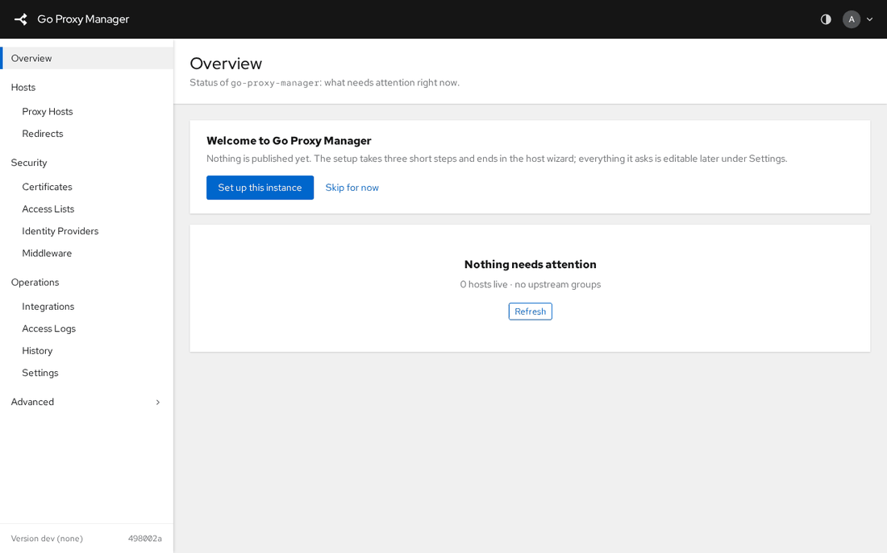

| Step | What it sets | Why it matters |
|---|---|---|
| Instance | `settings.appName`, `settings.externalBaseURL` | The name in the masthead and login page; the public URL single sign-on builds its redirect from, and what marks the session cookie `Secure` |
| Client addresses | `settings.trustedProxies` | Which proxies in front of gpm may say who the client is. Empty when gpm faces the internet directly |
| Review | nothing new | What gets committed, in one git commit |

- **Skip for now** hides the card for this browser. The wizard stays reachable
  from the account menu (**Setup wizard**).
- Read-only roles and HA followers never see it.

## The frame

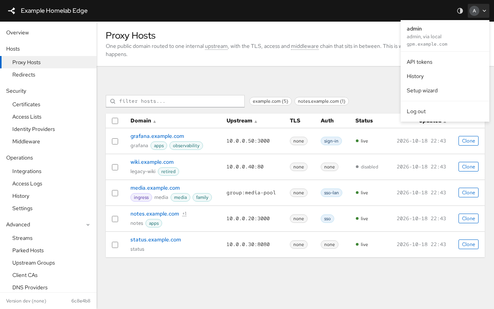

| Area | Holds |
|---|---|
| Masthead | The instance name, the theme button (auto, light, dark) and the account menu: who is signed in, role and sign-in method, the instance address, API tokens, History, the setup wizard, Log out |
| Sidebar | Overview, then the groups Hosts, Security, Operations and a collapsed Advanced group (streams, parked hosts, upstream groups, client CAs, DNS providers, error pages, API tokens). The foot shows the running version and the current config commit |
| Title band | The page title and one line of context; on an object page also the breadcrumb, the status label and the object actions |
| Content | Cards, tables and forms, on a grey canvas |

On a phone the sidebar becomes a drawer behind the menu button, tables scroll
sideways, and wizards open as full-screen sheets.

## Overview

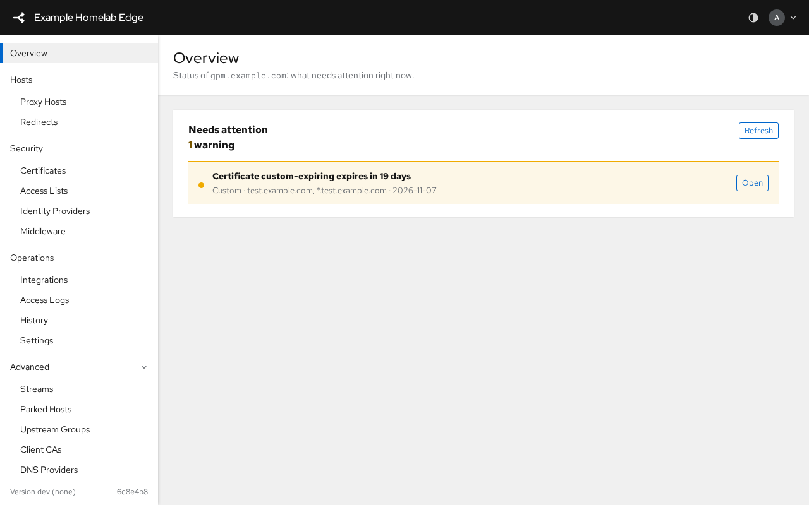

One list, **Needs attention**: certificates that failed to renew or are about to
expire, unhealthy upstream groups, discovery problems. Each row links to the
object. With nothing to report it says so and shows the live counts.

## Proxy hosts

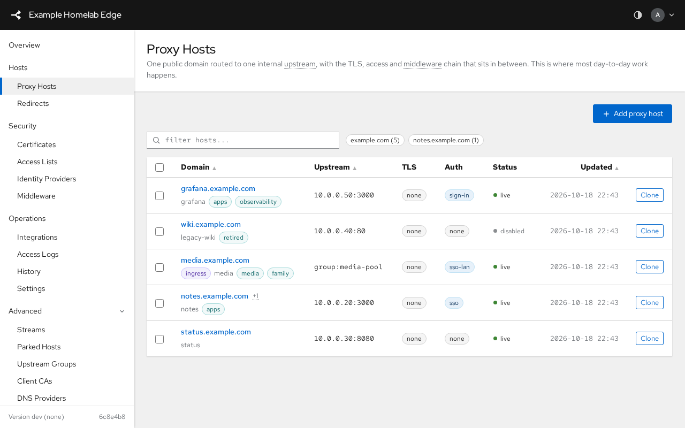

- One row per host: domains with their tags and a managed-by label, the
  upstream, the certificate, the sign-in gate, the status and the last change.
- Filter by text or by zone (the domain group chips). Sort by domain, upstream
  or last change.
- Select rows for bulk actions; **Clone** starts a new host from an existing one.
- **Add proxy host** opens the creation wizard below; the full editor stays one
  link away for anything the wizard does not ask.

## Creating a host with the wizard

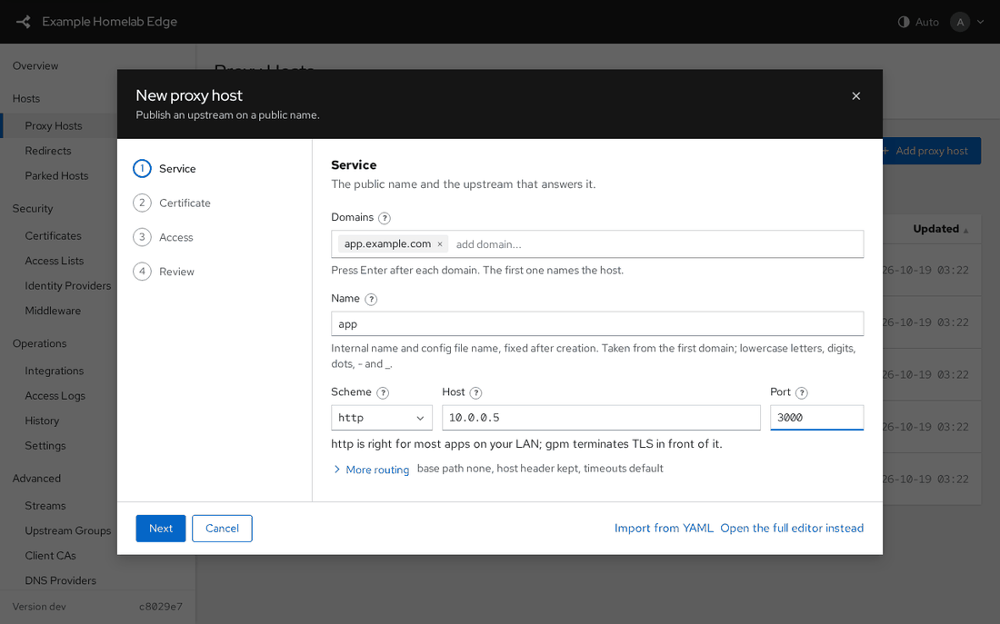

| Step | Asks for |
|---|---|
| Service | Domains, the internal name (derived from the first domain), the backend scheme, host and port; a base path under **More routing** |
| Certificate | Which certificate already covers the domains (chosen by SNI at the handshake, nothing to pick), Force SSL, HSTS |
| Access | A sign-in provider, access lists, middleware |
| Review | A summary and the exact YAML the server would commit, produced by a dry run with the same checks a save runs |

- A finished step summarizes what was chosen in the step list; click it to go
  back.
- **Import from YAML** fills the steps from a pasted document. Fields the steps
  do not cover are listed, and the full editor is offered with all of them.

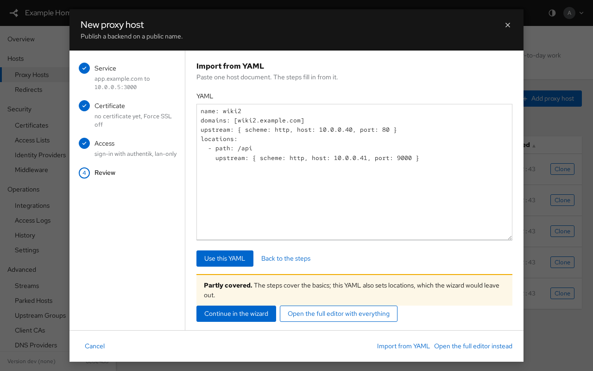

- **Create host** writes the object with a create-only request, so a name that
  already exists is refused rather than replaced.

## Editing an object

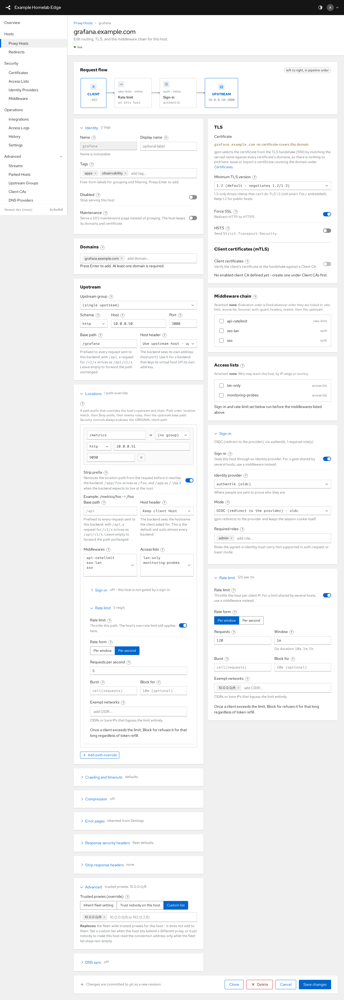

- The title band carries the breadcrumb, the live status and the last change.
- Sections are cards; rarely used settings sit behind expandable rows that
  summarize what they hold ("base path none, host header kept").
- A `?` next to a field opens its help, with a link into this documentation.
- **Save changes** commits one git revision. Validation errors stay on screen
  until the next attempt and point at the field.

## Certificates

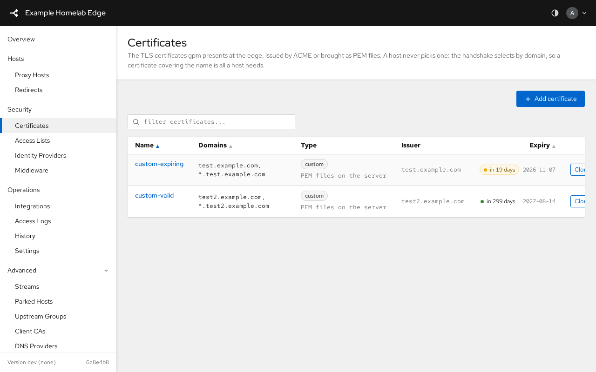

Each row shows the domains, the issuer, the state and the days left; the expiry
meter turns amber inside the renewal window. ACME certificates renew on their
own; **Renew now** forces it.

## Settings and history

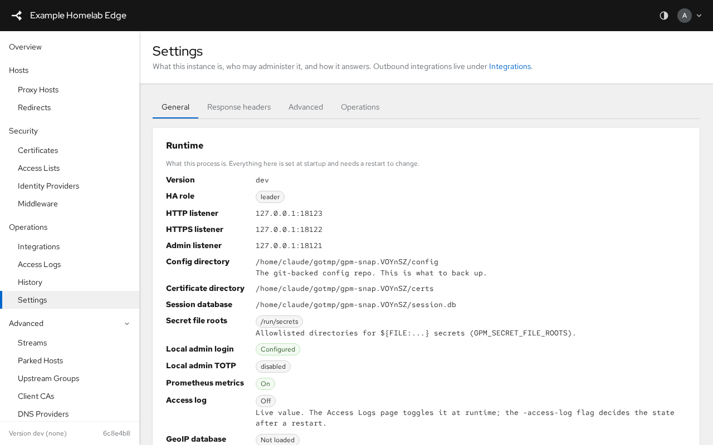

Settings are four tabs over one object; any tab's Save commits the whole thing.
History lists every commit with its author and lets you revert the whole config
or one object; Backup and Restore live on the same page.

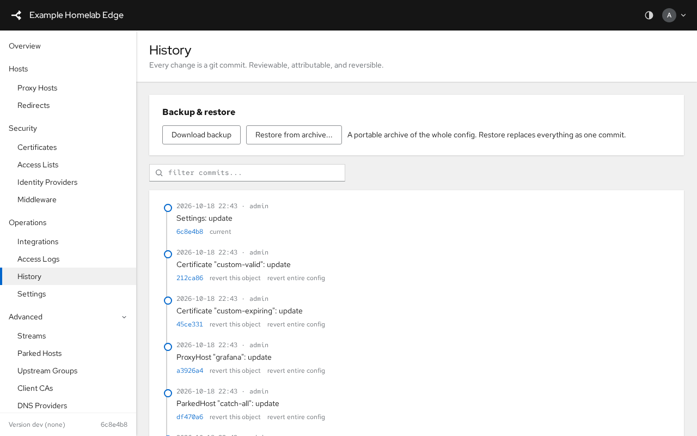

## Themes and keyboard

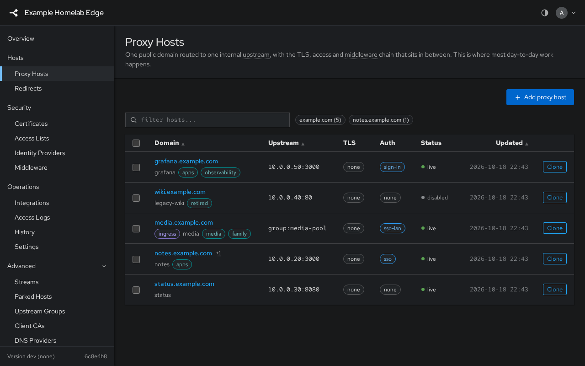

- Auto follows the operating system; light and dark are a click on the masthead
  button, remembered per browser.
- Every control is reachable by keyboard; dialogs trap focus and close on
  Escape with a discard prompt when something was typed.
- The panel loads no third-party asset: fonts, scripts and styles come from the
  binary, which is what lets its Content-Security-Policy stay `'self'`.
