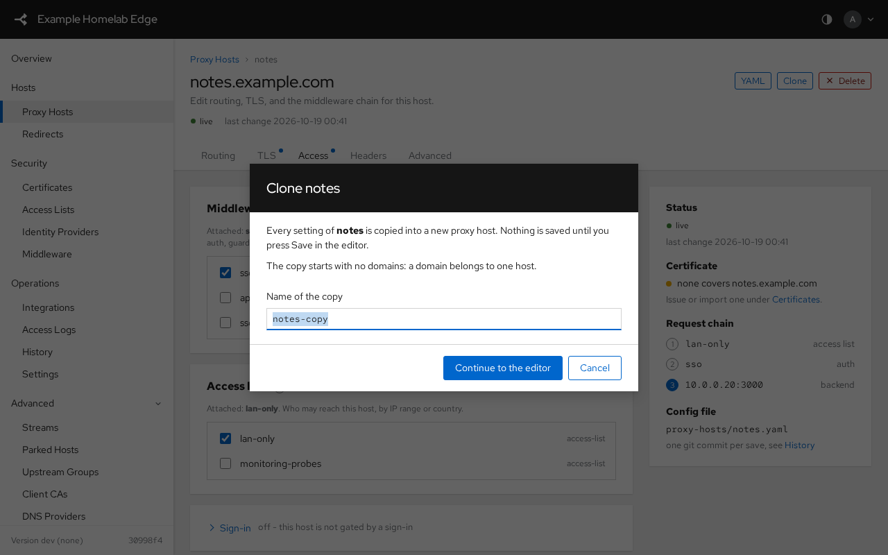

# Admin panel tour

What the embedded admin panel looks like and where things live. Every object the
panel edits is a YAML file in the config repository, so the API and a text editor
reach the same state.

## First sign-in and setup

A fresh instance greets the first admin with a setup card on the Overview. Three
steps, then the host wizard opens; everything it asks is editable later under
Settings.

| Step | What it sets | Why it matters |
|---|---|---|
| Instance | `settings.appName`, `settings.externalBaseURL` | The name in the masthead and login page; the public URL single sign-on builds its redirect from, and what marks the session cookie `Secure` |
| Client addresses | `settings.trustedProxies` | Which proxies in front of gpm may say who the client is. Empty when gpm faces the internet directly |
| Review | nothing new | What gets committed, in one git commit |

- **Skip for now** hides the card for this browser. The wizard stays reachable
  from the account menu (**Setup wizard**).
- Read-only roles and HA followers never see it.

## Signing in

The sign-in page opens with the app's masthead and shares its design and
theme. A wrong password, a wrong code or a lockout re-renders the page with the
reason and keeps the username.

## The frame

| Area | Holds |
|---|---|
| Masthead | The instance name, the theme button (auto, light, dark) and the account menu: who is signed in, role and sign-in method, the instance address, API tokens, History, the setup wizard, Sign out |
| Sidebar | Overview, then the groups Hosts (proxy hosts, redirects, parked hosts), Security, Operations and a collapsed Advanced group (streams, upstream groups, client CAs, DNS providers, error pages, API tokens). The foot shows the running version and the current config commit |
| Title band | The page title and one line of context; on an object page also the breadcrumb, the status label, the object actions and the tabs |
| Content | Cards, tables and forms, on a grey canvas |

On a phone or a portrait tablet the sidebar becomes a drawer behind the menu
button, the proxy hosts table keeps Domain and Status only (other tables scroll
sideways), and wizards open as full-screen sheets.

## Overview

One list, **Needs attention**: certificates that failed to renew or are about to
expire, unhealthy upstream groups, discovery problems. Each row links to the
object. With nothing to report it says so and shows the live counts.

## Proxy hosts

- One row per host: the domain (with the object or display name beside it
  when it differs), the upstream, the certificate that covers the first
  domain with its state (amber inside the renewal window, red when expired,
  "no certificate" when nothing covers it), the sign-in gate, the status, the
  tags (a discovered host's source, `k8s-managed` or `docker-managed`, is its
  first chip) and the last change.
- Filter by text, by field or by zone (the domain group chips). Every column
  sorts; the choice is remembered in the browser.
- Select rows for bulk actions: enable, disable, maintenance on or off, add or
  remove a tag. Each host is its own commit. Clone, YAML and Delete live on
  the host's own page, not in the list.
- Hover a row's Tags cell to see every tag; the chips show the first three.
- **Add proxy host** opens the creation wizard below; the full editor stays one
  link away for anything the wizard does not ask.

## Creating a host with the wizard

| Step | Asks for |
|---|---|
| Service | Domains, the internal name (derived from the first domain), the upstream scheme, host and port; a base path under **More routing** |
| Certificate | Which certificate already covers the domains (chosen by SNI at the handshake, nothing to pick), Force SSL (on by default only when every domain is covered), HSTS |
| Access | A sign-in provider, access lists, middleware |
| Review | A summary and the exact YAML the server would commit, produced by a dry run with the same checks a save runs |

- A finished step summarizes what was chosen in the step list; click it to go
  back.
- **Import from YAML** fills the steps from a pasted document. Fields the steps
  do not cover are listed, and the full editor is offered with all of them.

- **Add proxy host** writes the object with a create-only request, so a name
  that already exists is refused rather than replaced. Every editor's first
  save works the same way.
- **Open the full editor instead** carries what was typed into the editor.

## Editing a proxy host

- The title band carries the breadcrumb, the live status, the last change and
  the object actions: **YAML** (the config file as the server writes it),
  **Clone** and **Delete**.
- Five tabs split the form: Routing, TLS, Access, Headers, More. Every
  optional section says in its summary line what it holds, and the line
  follows your edits.
- The rail keeps the status, the certificate the handshake will present, the
  request chain in evaluation order and the config file path in view while
  you edit.
- Sections are cards; rarely used settings sit behind expandable rows that
  summarize what they hold ("base path none, host header kept").
- A `?` next to a field opens its help, with a link into this documentation.
- **Save changes** makes one git commit; a save that changes nothing makes
  none and says "No changes". Validation errors stay on screen until the
  next attempt, point at the field and switch to its tab.
- **Delete** asks in a dialog that names the hosts still using the object; a
  refused delete stays on screen with the reason.

- **Clone** asks for the copy's name first, checked against the names in use,
  then opens the editor on the copy. Nothing is saved until you press Save.
  Domains are cleared, since a domain belongs to one host; labels and
  secrets are not copied.
- The other object editors are one page of cards with the same title band:
  Clone and Delete (and Renew now on an ACME certificate) sit there too, and
  Clone asks for the name the same way.
- The other list pages are tables like Proxy Hosts: one row per object, one
  column per summary field, values wrapped rather than cut short, every
  column sortable, and the whole row opens the object.

## Filtering a list

Every list has the same filter box.

| Typed | Matches |
|---|---|
| `lan` | The word anywhere in the row's values (never in its markup) |
| `tag:lan` | Only the `tag` field; the box's tooltip lists the fields of that list |
| `-status:disabled` | Excludes; works on a word too (`-lan`) |
| `name:"two words"` | A value with spaces |
| `status:5xx` | Access Logs: a status class; `status:404` a code |
| `status:4xx,5xx` | Alternatives: the term holds when any of them does |
| `client:10.0.0.0/8` | Access Logs: the client address inside a network; an IP (`client:10.10.2.55`) matches exactly |
| `-client:@home-only` | Access Logs: every client outside the networks the `home-only` access list allows |

- Typing suggests the field names, then the values present in the list; Enter
  or a click takes a suggestion, Escape closes it.
- A complete `field:value` term becomes a chip when you type a space; the
  chips and the words in the box combine. Backspace on an empty box pulls the
  last chip back for editing.
- The matched text is highlighted in the rows.
- A field whose left side is not a field name is just a word, so an upstream
  written `group:k8s` is found by typing it.
- Commas split a scoped term into alternatives; quote the value
  (`path:"/a,b"`) to keep a literal comma.

## Access Logs

- The most recent proxied requests held in memory, newest first, while
  capture is on. **Enable capture** turns it on live (until the next
  restart); `-access-log` or `GPM_ACCESS_LOG=1` makes it the startup default.
- **Auto-refresh** reloads the rows in place at the chosen interval, keeping
  the filter, the sort and the scroll position; **Refresh** does it once.
  Refreshing pauses while the tab is hidden.
- **Clear** empties the buffer after a confirmation; capture is unchanged.
- With capture off the page says so where the rows would be; there is no
  banner to dismiss.
- The count line says how many of the captured requests the filter shows and
  how many the buffer holds. Filter fields: `method`, `host`, `path`,
  `status` (a code or a class such as `4xx`), `client` and `slow:yes`
  (requests over one second).
- `client` matches by address: a CIDR (`client:10.0.0.0/8`,
  `client:2001:db8::/32`) takes every client inside it, a bare IP matches
  exactly, and `@name` stands for the networks the access list `name` allows:
  its literal `cidr` rules plus what its named sources last fetched, so a
  list fed by a monitoring provider's published IP list hides that monitor
  with `-client:@name`. Anything else is a substring of the logged address, so
  `client:10.10.2.` still works. To review what reached a host from outside
  your own networks, exclude the list that names them: `-client:@home-only`,
  or several at once with `-client:@home-only,@home-vpn`. The suggestions
  under `client:` offer the `@` lists first.

## Certificates

Each row shows the domains, the issuer, the state and the days left; the expiry
meter turns amber inside the renewal window. ACME certificates renew on their
own; **Renew now** forces it.

## Settings and history

Settings are four tabs in the title band over one object; any tab's Save commits the whole thing.
Integrations is tabbed the same way, one tab per outbound system.
API Tokens: **Edit** on a token changes its scopes and expiry in place; the
secret keeps working, and only **Rotate** mints a new one.
History lists every commit with its author. **Changes** on a commit opens
every file it touched as a diff; tick **Compare** on two commits to see
everything that changed between them, oldest to newest. Revert the whole
config or one object from the same row; Backup and Restore live on the same
page.

## Themes and keyboard

- Auto follows the operating system; light and dark are a click on the masthead
  button, remembered per browser.
- Every control is reachable by keyboard; dialogs trap focus and close on
  Escape with a discard prompt when something was typed.
- The panel loads no third-party asset: fonts, scripts and styles come from the
  binary, which is what lets its Content-Security-Policy stay `'self'`.
