# Admin panel tour

What the embedded admin panel looks like and where things live. Every object the
panel edits is a YAML file in the config repository, so the API and a text editor
reach the same state.

## First sign-in and setup

A fresh instance greets the first admin with a setup card on the Overview. Three
steps, then the host wizard opens; everything it asks is editable later under
Settings.

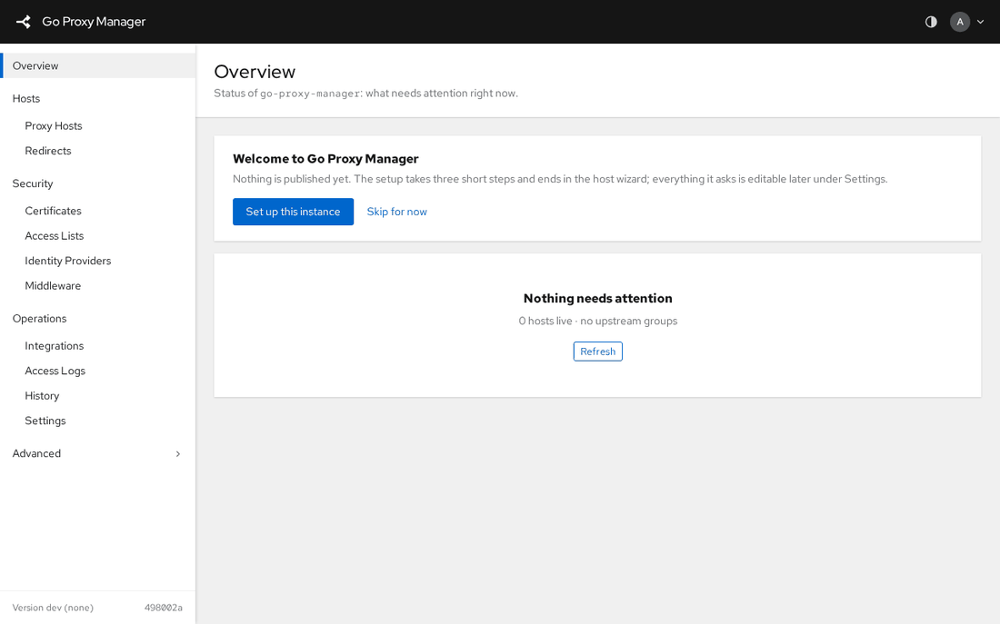

| Step | What it sets | Why it matters |
|---|---|---|
| Instance | `settings.appName`, `settings.externalBaseURL` | The name in the masthead and login page; the public URL single sign-on builds its redirect from, and what marks the session cookie `Secure` |
| Client addresses | `settings.trustedProxies` | Which proxies in front of gpm may say who the client is. Empty when gpm faces the internet directly |
| Review | nothing new | What gets committed, in one git commit |

- **Not offered on a failed read.** When the object counts could not be read,
  the card stays hidden rather than reading them as zero.
- **Skip for now** hides the card for this browser. The wizard stays reachable
  from the account menu (**Setup wizard**).
- Read-only roles and HA followers never see it.

## Signing in

The sign-in page opens with the app's masthead and shares its design and
theme. A wrong password, a wrong code or a lockout re-renders the page with the
reason and keeps the username.

## The frame

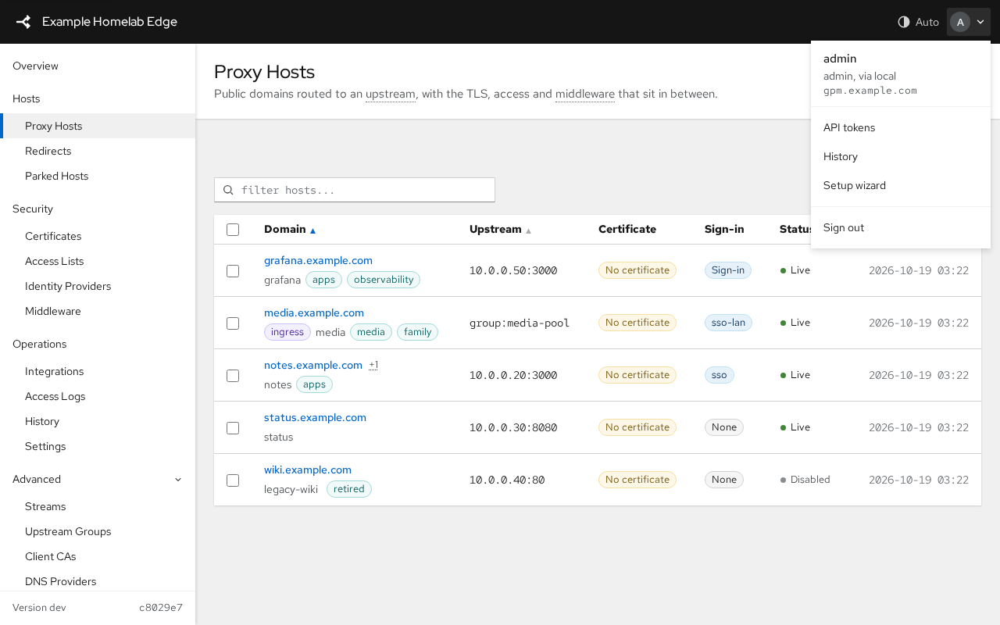

| Area | Holds |
|---|---|
| Masthead | The instance name, the theme button (auto, light, dark) and the account menu: who is signed in, role and sign-in method, the instance address, API tokens, History, the setup wizard, Sign out |
| Sidebar | Overview, then the groups Hosts (proxy hosts, redirects, parked hosts), Security, Operations and a collapsed Advanced group (streams, upstream groups, client CAs, DNS providers, error pages, API tokens). The foot shows the running version and the current config commit |
| Title band | The page title and one line of context; on an object page also the breadcrumb, the status label, the object actions and the tabs |
| Content | Cards, tables and forms, on a grey canvas |

On a phone or a portrait tablet the sidebar becomes a drawer behind the menu
button, the proxy hosts table keeps Domain and Status only (other tables scroll
sideways), and wizards open as full-screen sheets.

## Overview

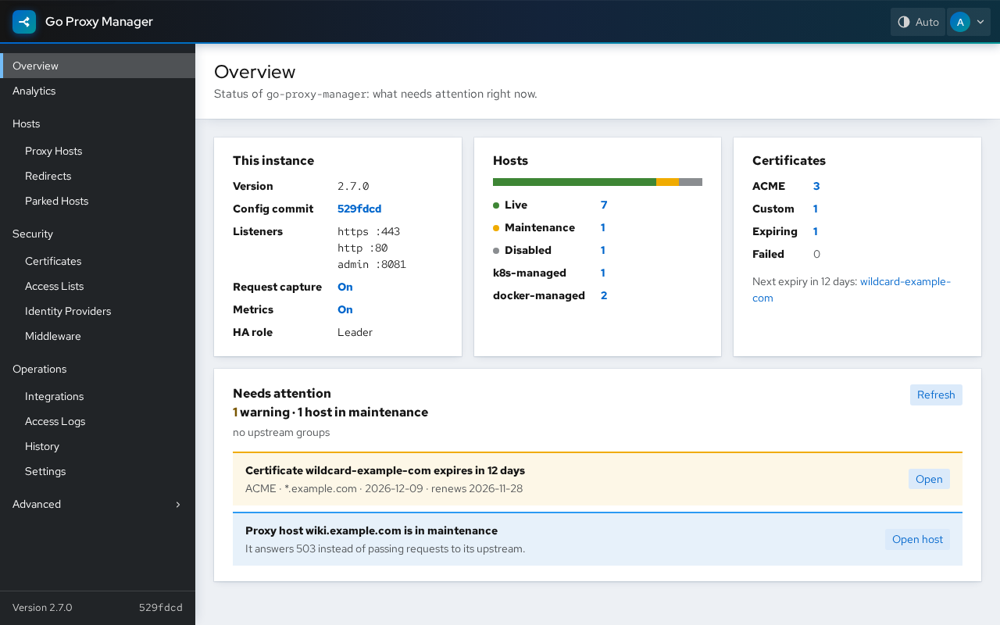

Three panels sit ahead of the **Needs attention** list.

| Panel | Shows |
|---|---|
| This instance | Version, config commit (links to History), the `https`, `http` and `admin` listener addresses, request capture (On or Off, links to Access Logs, where it is switched), metrics (On or Off, links to Settings > Advanced; `GPM_METRICS=1` at startup switches it) and the HA role (Leader, or Follower (read-only) on an HA follower) |
| Hosts | A bar and counts by status (Live, Maintenance, Disabled), then a count per discovery source that owns at least one host (`k8s-managed`, `docker-managed`) |
| Certificates | Counts of ACME and custom certificates, Expiring, Failed and (when any) Expired, then the next expiry: the enabled, valid or expiring certificate with the fewest days left, linked |

- **A non-zero count is a link.** It opens the list with the matching filter
  applied, for example `#/hosts?filter=status:maintenance` or
  `#/certs?filter=state:expiring` (see [Filtering a list](#filtering-a-list));
  a zero is plain text.
- **Needs attention** lists certificates that failed, expired or are about to
  expire, unhealthy upstream groups, discovery problems, config warnings, hosts
  in maintenance and a failed proxy hosts, certificates, health or discovery
  read ("Could not read proxy hosts" for the first); each row links to the
  object, and with nothing to report it reads "Nothing needs attention".
- **Certificate rows.** A custom certificate in error reads "could not be
  loaded"; an ACME one reads "has no usable certificate" (it was never issued,
  or its stored certificate cannot be read). Expiry reads "expires in N days", "expires in 1 day", "expires
  tomorrow" or "expires today", and one that ended less than a day ago "expired
  today" or "expired yesterday".
- **Summary line.** The line under the heading holds only the upstream members
  sentence, for example "4 of 4 upstream members healthy" or "no upstream
  groups".
- **A failed read.** This instance shows "unavailable" in each row it could not
  read, Certificates shows only a sentence, and Hosts shows a sentence plus
  Total and Disabled when the sidebar's counts were readable.
- **Empty panels.** With no hosts or no certificates yet the panel says so and
  offers **Add proxy host** or **Add certificate**; a read-only user sees the
  sentence without the button.

## Analytics

- Traffic through the edge for one range: six tiles (requests, denied, threat
  hits, 5xx, p95, bytes out), a column chart of allowed and denied requests
  with threat hits as a line, three small charts, then countries, denial
  reasons, threat signatures, hosts and top clients.
- **Range**, **Host**, **Source** and **Auto-refresh** on top scope everything
  below. Picking a host (or clicking a row in the Hosts table) opens
  `#/analytics/<name>`; `no host (-)` is traffic that matched no proxy host.
  **Source** shows all traffic, only requests from public addresses, or only
  requests from private, loopback, link-local and configured internal networks
  (Settings, General, Analytics, **Internal networks**).
- Hover a column for the bucket's numbers; arrow keys step buckets when the
  chart has focus; **Table** swaps the chart for the same numbers as rows.
- Country code, client address and signature cells copy on hover (the small
  copy button that appears on the row).
- Off by default: switch it on under Settings, General, **Analytics** (retention
  and the top-clients mode live there too); see the
  [Analytics reference](../reference/analytics.md).

## Proxy hosts

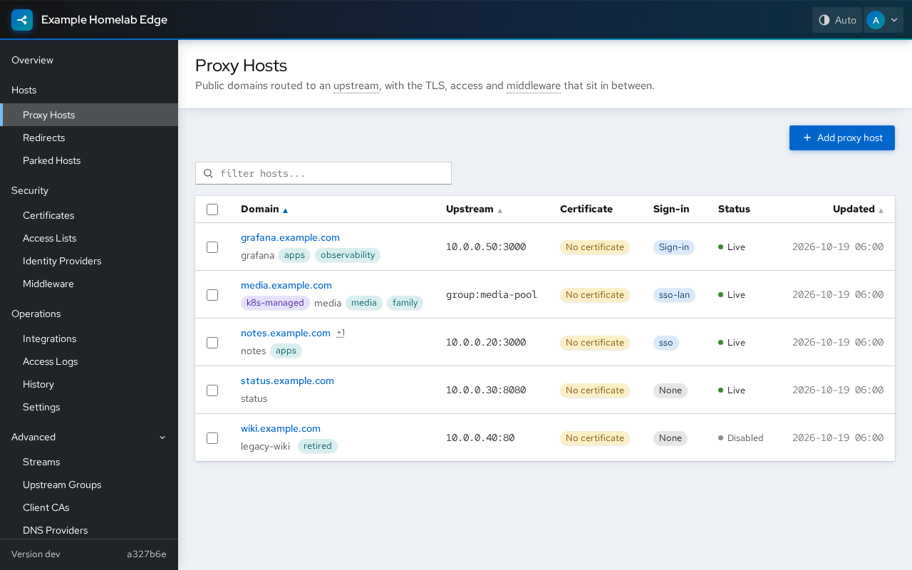

- One row per host: the domain (with the object or display name beside it
  when it differs), the upstream, the certificate that covers the first
  domain with its state (amber inside the renewal window, red when expired,
  "no certificate" when nothing covers it), the sign-in gate, the status, the
  tags (a discovered host's source, `k8s-managed` or `docker-managed`, is its
  first chip) and the last change.
- Filter by text, by field or by zone (the domain group chips). Every column
  sorts; the choice is remembered in the browser.
- Select rows for bulk actions: enable, disable, maintenance on or off, add or
  remove a tag. Each host is its own commit. Clone, YAML and Delete live on
  the host's own page, not in the list.
- Hover a row's Tags cell to see every tag; the chips show the first three.
- **Add proxy host** opens the creation wizard below; the full editor stays one
  link away for anything the wizard does not ask.

## Wizards

Two objects have a creation wizard: proxy hosts and ACME certificates. Both
use the same step list, Review dry run, **Import from YAML** and **Open the
full editor instead** controls.

## Creating a host with the wizard

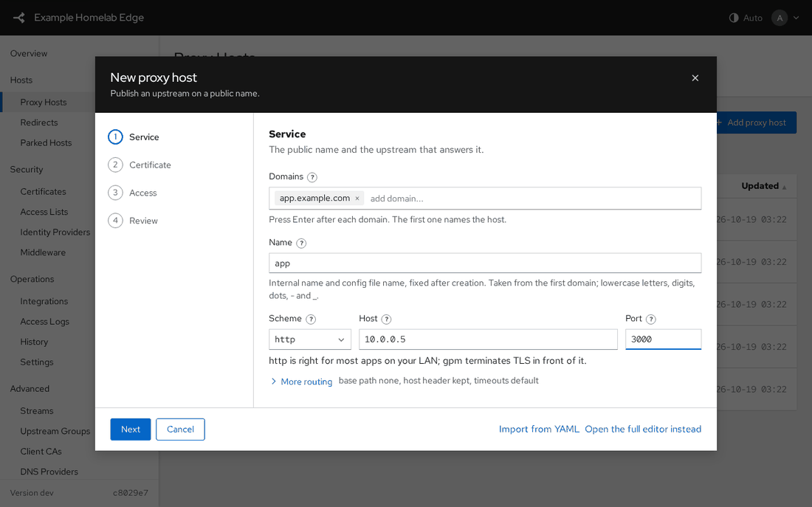

| Step | Asks for |
|---|---|
| Service | Domains, the internal name (derived from the first domain), the upstream scheme, host and port; a base path under **More routing** |
| Certificate | Which certificate already covers the domains (chosen by SNI at the handshake, nothing to pick), Force SSL (on by default only when every domain is covered), HSTS |
| Access | A sign-in provider, access lists, middleware |
| Review | A summary and the exact YAML the server would commit, produced by a dry run with the same checks a save runs |

- A finished step summarizes what was chosen in the step list; click it to go
  back.
- **Import from YAML** fills the steps from a pasted document. Fields the steps
  do not cover are listed, and the full editor is offered with all of them.
  When the server reports the document invalid, the steps are still filled and
  the server's message follows the step's own, as `The pasted YAML: <server
  text>`, at a step that objects; Review shows nothing from the import, only
  the check of the filled draft.
- **Add on Review.** Pressing **Add** before the server check has answered
  shows "Wait for the server check to finish." When the server cannot
  be reached, Review says so; go **Back**, then **Next** to check again.

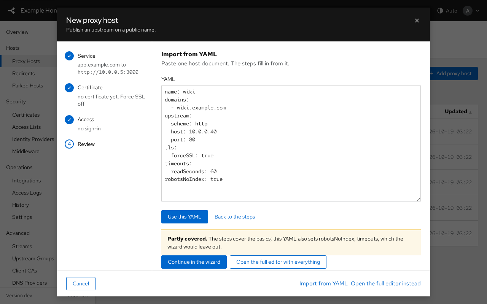

- **Add proxy host** writes the object with a create-only request, so a name
  that already exists is refused rather than replaced. Every editor's first
  save works the same way.
- **Open the full editor instead** carries what was typed into the editor.

## Editing a proxy host

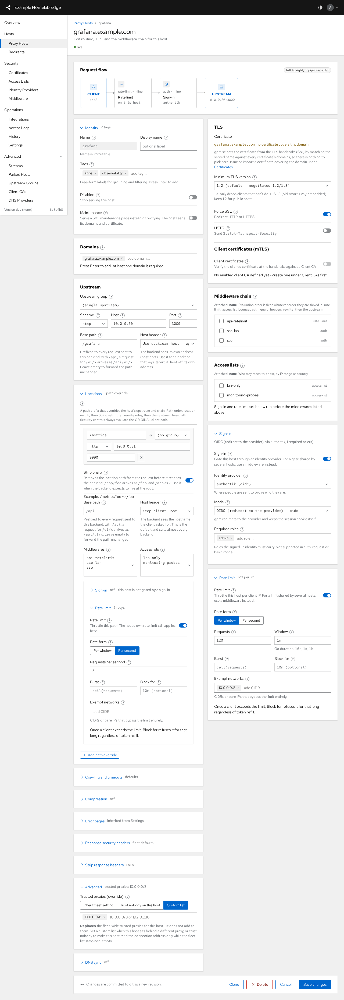

- The title band carries the breadcrumb, the live status, the last change and
  the object actions: **YAML** (the config file as the server writes it),
  **Clone** and **Delete**.
- Five tabs split the form: Routing, TLS, Access, Headers, More. Every
  optional section says in its summary line what it holds, and the line
  follows your edits.
- The rail keeps the status, the certificate the handshake will present, the
  request chain in evaluation order and the config file path in view while
  you edit.
- Sections are cards; rarely used settings sit behind expandable rows that
  summarize what they hold ("base path none, host header kept").
- A `?` next to a field opens its help, with a link into this documentation.
- **Save changes** makes one git commit; a save that changes nothing makes
  none and says "No changes". Validation errors stay on screen until the
  next attempt, point at the field and switch to its tab.
- **Delete** asks in a dialog that names the hosts still using the object; a
  refused delete stays on screen with the reason.

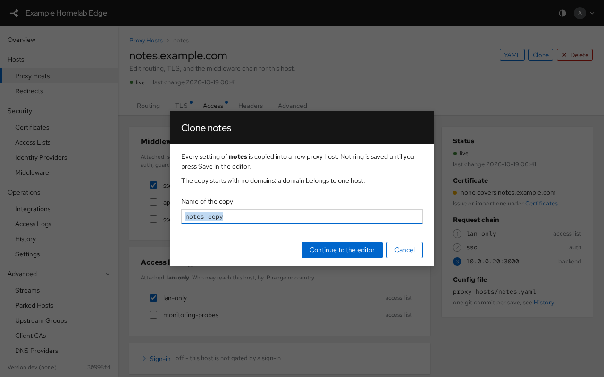

- **Clone** asks for the copy's name first, checked against the names in use,
  then opens the editor on the copy. Nothing is saved until you press Save.
  Domains are cleared, since a domain belongs to one host; labels and
  secrets are not copied.
- The certificate editor uses the same layout, described under
  [Editing a certificate](#editing-a-certificate). The other object editors are one page of
  cards with the same title band: Clone and Delete sit there too, and Clone
  asks for the name the same way.
- The other list pages are tables like Proxy Hosts: one row per object, one
  column per summary field, values wrapped rather than cut short, every
  column sortable, and the whole row opens the object.

## Filtering a list

Every list has the same filter box.

| Typed | Matches |
|---|---|
| `lan` | The word anywhere in the row's values (never in its markup) |
| `tag:lan` | Only the `tag` field; the box's tooltip lists the fields of that list |
| `-status:disabled` | Excludes; works on a word too (`-lan`) |
| `name:"two words"` | A value with spaces |
| `status:5xx` | Access Logs: a status class; `status:404` a code |
| `status:4xx,5xx` | Alternatives: the term holds when any of them does |
| `client:10.0.0.0/8` | Access Logs: the client address inside a network; an IP (`client:192.0.2.55`) matches exactly |
| `-client:@lan-only` | Access Logs: every client outside the networks the `lan-only` access list allows |
| `country:RU` | Access Logs: the client's ISO country code, when a GeoIP database is loaded |

- **Deep links.** `#/hosts?filter=<text>` or `#/certs?filter=<text>` opens
  that list with the text in the box as if typed; the Overview counts are such
  links (`status:live`, `source:docker-discovery`, `type:acme`, `state:error`).
- The link's filter replaces the remembered one and is remembered in its place;
  once the list is shown the address drops back to `#/hosts` or `#/certs`.
  Only those two lists take it; on any other page the query is ignored.
- On the proxy hosts list a link also switches every zone chip back on, so the
  rows shown are exactly the ones the link names.
- Typing suggests the field names, then the values present in the list; Enter
  or a click takes a suggestion, Escape closes it.
- A complete `field:value` term becomes a chip when you type a space; the
  chips and the words in the box combine. Backspace on an empty box pulls the
  last chip back for editing.
- The matched text is highlighted in the rows.
- A field whose left side is not a field name is just a word, so an upstream
  written `group:k8s` is found by typing it.
- Commas split a scoped term into alternatives; quote the value
  (`path:"/a,b"`) to keep a literal comma.
- The last filter typed on a list comes back when you return to it (kept in
  this browser), unless a deep link brings its own.
- **Saved** beside the box lists the named filters stored for this list:
  pick one to apply it, **Save current filter...** keeps what is in the box
  under a name, and the x beside an entry deletes it. Saved filters live in
  settings (`savedFilters`, see [Saved filters](../reference/config/settings/saved-filters.md)),
  so they are offered on every browser you sign in from and show in History.

## Access Logs

- The most recent proxied requests held in memory, newest first, while
  capture is on. **Enable capture** turns it on live (until the next
  restart); `-access-log` or `GPM_ACCESS_LOG=1` makes it the startup default.
- **Paging**: the table shows one page of the buffer (50, 100, 250 or 500
  rows, remembered in the browser). The pager stays pinned to the bottom of
  the page; the filter and the sort apply to every buffered request, not to
  the page on screen.
- **Buffer** sets how many requests are kept (up to 100,000), which is how
  far back the pages reach.
- **Auto-refresh** reloads the rows in place at the chosen interval, keeping
  the filter, the sort and the scroll position; **Refresh** does it once.
  Auto-refresh pauses while the tab is hidden or a page after the first is
  open.
- **Clear** empties the buffer after a confirmation; capture is unchanged.
- **Export** downloads every request the filter matches, across all pages
  and in the table's order, as CSV or JSON
  (`gpm-access-log-<timestamp>.csv|json`); with no filter that is the whole
  buffer. A CSV cell that would read as a spreadsheet formula is prefixed
  with a quote.
- With capture off the page says so where the rows would be; there is no
  banner to dismiss.
- The count line says how many of the captured requests the filter shows and
  how many the buffer holds. Filter fields: `method`, `host`, `path`,
  `status` (a code or a class such as `4xx`), `client`, `country` (with a
  GeoIP database loaded), `source` (`internal` for private, loopback,
  link-local and configured internal-network clients, else `external`; the
  same split as the Analytics Source filter) and `slow:yes` (requests over one
  second).
- With `GPM_GEOIP_DB` set, a **Country** column shows the client's ISO code
  (private and unknown addresses stay blank); the CSV export gains the same
  column and the JSON log line a `country` field.
- A request that an access-control tier refused carries the reason in a `deny` field on the JSON log line and on each `GET /api/logs` entry (omitted when nothing refused it). The reasons are the denial reasons listed under [`gpm_denials_total`](../reference/metrics.md).
- Host, path, client and country cells copy on hover: a small copy button
  appears on the row; a path with control characters is copied percent-encoded.
- `client` matches by address: a CIDR (`client:10.0.0.0/8`,
  `client:2001:db8::/32`) takes every client inside it, a bare IP matches
  exactly, and `@name` stands for the networks the access list `name` allows:
  its literal `cidr` rules plus what its named sources last fetched, so a
  list fed by a monitoring provider's published IP list hides that monitor
  with `-client:@name`. Anything else is a substring of the logged address, so
  `client:192.0.2.` still works. To review what reached a host from outside
  your own networks, exclude the list that names them: `-client:@lan-only`,
  or several at once with `-client:@lan-only,@lan-vpn`. The suggestions
  under `client:` offer the `@` lists first.

## Certificates

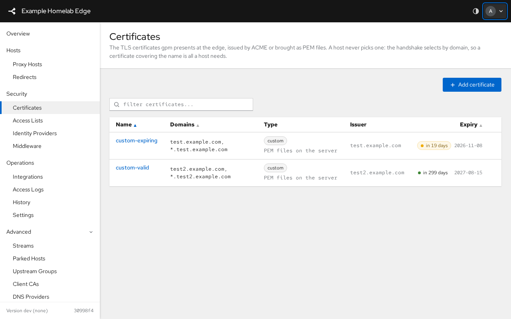

Each row shows the domains, the issuer, the state and the days left; the expiry
meter turns amber inside the renewal window. ACME certificates renew on their
own; **Renew now** forces it.

### Adding a certificate

**Add certificate** opens a four-step wizard for ACME certificates.

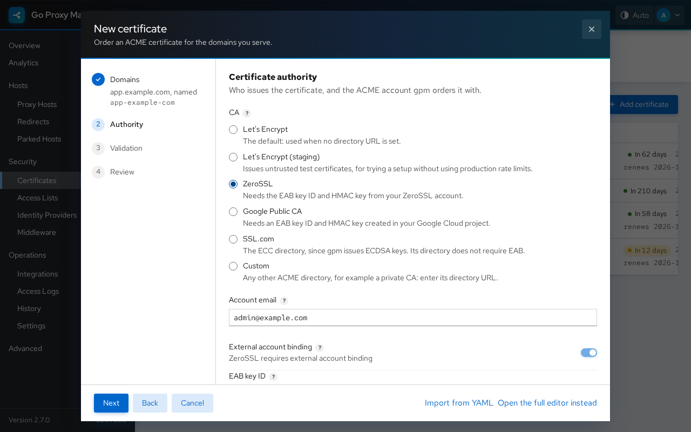

| Step | Asks for |
|---|---|
| Domains | The names to cover and the internal name. The name follows the first domain until you edit it: `example.com` gives `example-com`, `*.example.com` gives `wild-example-com` |
| Authority | The CA, the account email, external account binding, and under **More** an issuance profile and (Custom CA only) a CA bundle |
| Validation | `http-01` or `dns-01`, and for `dns-01` the DNS provider (`dns-01` is the default when a provider exists). A wildcard domain forces `dns-01`; otherwise, with no DNS provider configured, `dns-01` is greyed out with the reason |
| Review | A summary and the exact YAML the server would commit, from a dry run with the same checks a save runs |

- **CA picker.** Let's Encrypt, Let's Encrypt (staging), ZeroSSL, Google Public
  CA, SSL.com or Custom; the directories behind each label are in the
  [Certificate reference](../reference/config/certificate.md#certificate-ca-directories).
- **Custom needs a URL.** Custom shows a **Directory URL** field for any other
  ACME directory, and the step does not continue while it is blank.
- **External account binding.** Picking ZeroSSL or Google Public CA turns the
  switch on and locks it; the requirement follows the directory URL that will
  be written, so a typed URL of either CA needs it too.
- **Secrets out of git.** Enter the EAB HMAC key as a `${ENV:...}` or
  `${FILE:...}` placeholder.
- **Stored as a plain URL.** The picker only fills `acme.directoryURL`; nothing
  else about the object changes.
- **Review waits for the server.** **Add certificate** asks you to wait until
  the dry run has answered, and a rejected dry run or a taken name blocks it.
- **Import from YAML** fills the steps from a `type: acme` document and lists
  the fields they do not cover; a `type: custom` document only opens in the
  full editor, any other type is refused, and a literal EAB HMAC key is left
  out (enter it as a placeholder).
- **Create-only save.** As in the host wizard, a name that already exists is
  refused rather than replaced.
- **Open the full editor instead** carries what was typed into the editor as a
  new, unsaved certificate.
- **Custom certificates** (PEM files already in the server's cert store) are
  not ordered over ACME: use **Open the full editor instead** and set **Type**
  to **Custom (PEM files already on the server)**.
- **When it is ordered.** The manager orders the certificate at its next pass,
  not when you add it; **Renew now** on its page orders at once.

### Editing a certificate

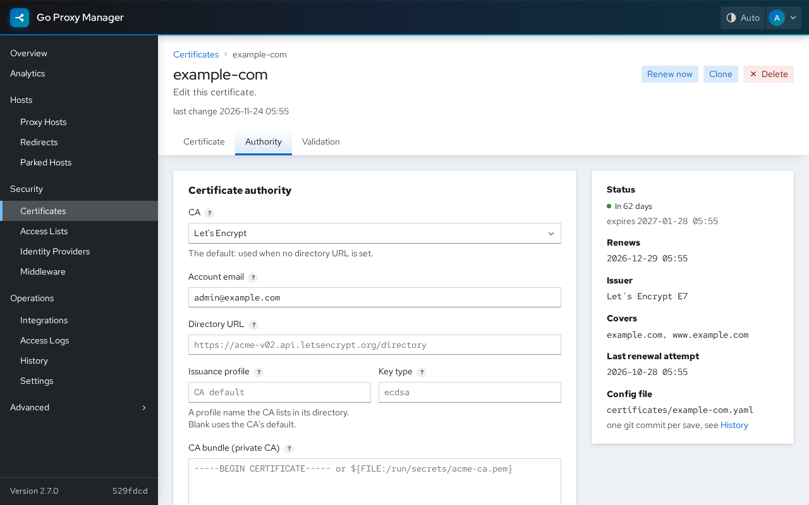

- The editor has the proxy host editor's layout. Tabs sit in the title band:
  Certificate, Authority and Validation for an ACME certificate; Certificate and
  Files for a custom one. Changing **Type** swaps the tab set.
- The title band carries **Renew now** (ACME only, starts an order at once and
  refreshes the rail), **Clone** and **Delete**.
- The Authority tab has the same CA picker; choosing a CA fills **Directory
  URL**, and typing a URL that belongs to a preset selects it. A warning shows
  while a private **CA bundle** is set and the directory URL that will be
  written is a public CA (or blank with a preset picked), because the bundle
  replaces the system roots and orders fail until it is cleared.
- A save that does not touch **Challenge** writes no `acme.challenge` the
  certificate did not already have.
- The rail on the right shows the status and expiry, the next renewal (ACME),
  the issuer, the names covered, the last renewal attempt and its error, if
  any (ACME), and the config file path; a new certificate shows New and the
  path its first save writes.

## Settings and history

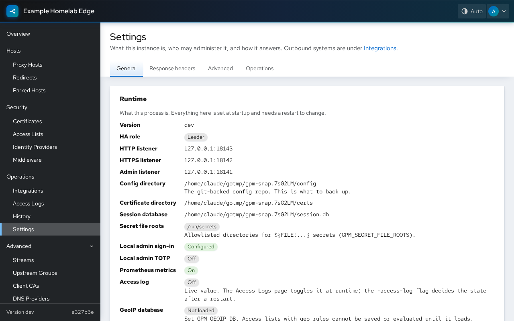

Settings are four tabs in the title band over one object; any tab's Save commits the whole thing.
Integrations is tabbed the same way, one tab per outbound system.
API Tokens: **Edit** on a token changes its scopes and expiry in place; the
secret keeps working, and only **Rotate** mints a new one.
History lists every commit with its author. **Changes** on a commit opens
every file it touched as a diff; tick **Compare** on two commits to see
everything that changed between them, oldest to newest. Revert the whole
config or one object from the same row; Backup and Restore live on the same
page.

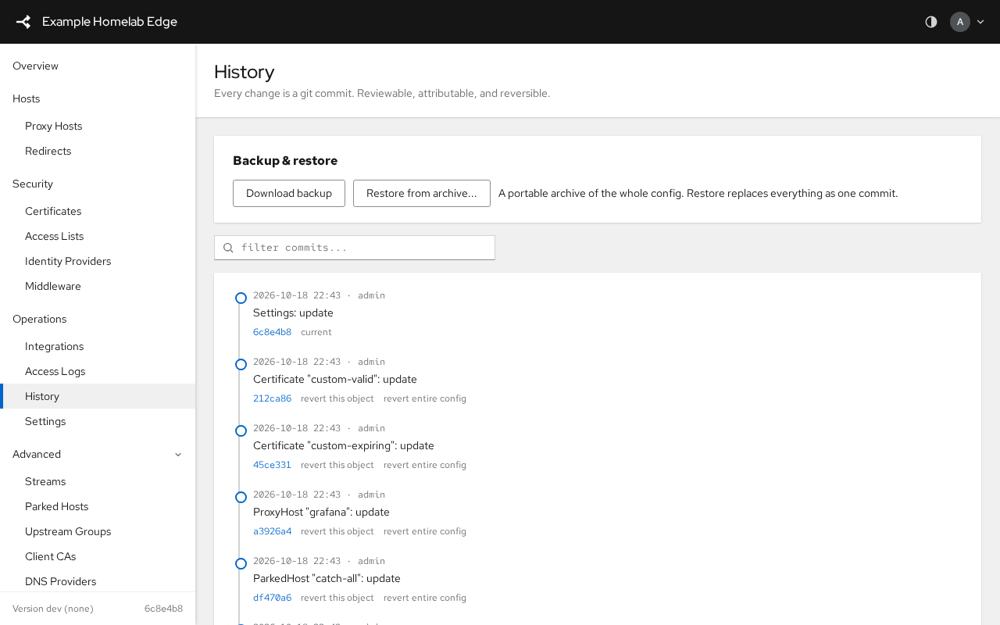

## Themes and keyboard

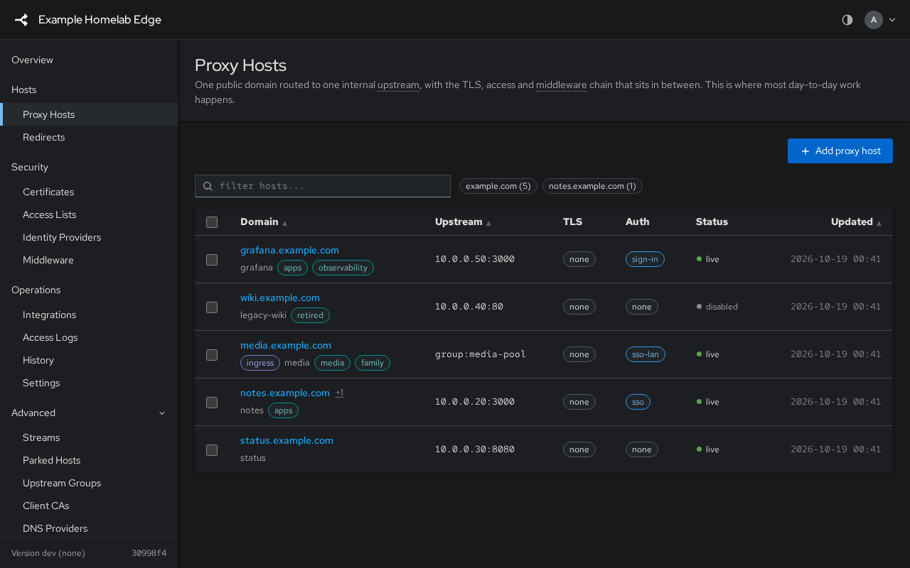

- Auto follows the operating system; light and dark are a click on the masthead
  button, remembered per browser.
- Every control is reachable by keyboard; dialogs trap focus and close on
  Escape with a discard prompt when something was typed.
- The panel loads no third-party asset: fonts, scripts and styles come from the
  binary, which is what lets its Content-Security-Policy stay `'self'`.
